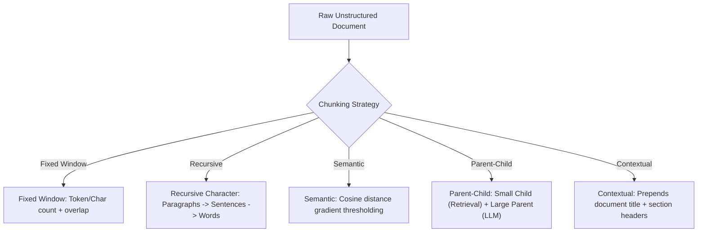

# Advanced Document Chunking: Strategies, Trade-offs & Deep Dive

Chunking is the foundational transformation in any RAG system. If a chunking strategy produces fragmented, out-of-context, or overly noisy text spans, no downstream retrieval or reranking algorithm can recover the lost information.

---

## 1. Chunking Strategies Compared

---

## 2. Deep Dive by Strategy

### A. Fixed-Window Chunking (`FixedWindowChunker`)
- **Mechanism**: Splits text into invariant token or character windows $W$ with a fixed step size $S = W - \text{overlap}$.
- **Formula**:
  $$\text{Chunk}_k = T[k \cdot S : k \cdot S + W]$$
- **Pros**: $O(N)$ computational complexity; guarantees deterministic token bounds matching embedding context windows.
- **Cons**: High semantic boundary failure rate—splits sentences, code blocks, or mathematical formulas mid-thought.
- **When to Use**: High-throughput preliminary indexing of flat, homogeneous text where low ingestion latency is paramount.

---

### B. Recursive Character Chunking (`RecursiveCharacterChunker`)
- **Mechanism**: Attempts to split along natural hierarchical linguistic boundaries in order:
  $$\text{Separators} = [\text{"\n\n"}, \text{"\n"}, \text{". "}, \text{"? "}, \text{"! "}, \text{"; "}, \text{", "}, \text{" "}, \text{""}]$$
- **Algorithm**: Recursively breaks segments until all children satisfy `chunk_size`. Merges adjacent segments with `chunk_overlap` to maintain narrative flow.
- **Pros**: Preserves paragraph unity, list integrity, and sentence coherence.
- **Cons**: Chunk token lengths are non-uniform; requires careful separator tuning for specialized code or tables.
- **When to Use**: Default general-purpose choice for markdown, articles, and documentation.

---

### C. Semantic Chunking (`SemanticChunker`)
- **Mechanism**: Evaluates embedding distance gradients between adjacent sentences:
  1. Break document into discrete sentences $S = \{s_1, s_2, \dots, s_n\}$.
  2. Compute normalized dense embedding $\mathbf{v}_i = \text{Embed}(s_i)$.
  3. Calculate cosine distance between consecutive sentences:
     $$d_i = 1 - \cos(\mathbf{v}_i, \mathbf{v}_{i+1}) = 1 - \frac{\mathbf{v}_i \cdot \mathbf{v}_{i+1}}{\|\mathbf{v}_i\| \|\mathbf{v}_{i+1}\|}$$
  4. Instantiate a chunk boundary whenever $d_i \ge \text{Percentile}(D, P)$, typically $P = 80\%$.
- **Pros**: Chunks naturally align with thematic shifts (e.g., transition from "Security Specs" to "Billing").
- **Cons**: Higher computational overhead during ingestion ($O(N)$ embedding passes).
- **When to Use**: Dense technical manuals, textbooks, legal agreements, and policy briefs.

---

### D. Parent-Child Hierarchical Chunking (`ParentChildChunker`)
- **The Core Dilemma**:
  - Small chunks (100-250 tokens) produce sharp, high signal-to-noise vector embeddings for similarity search, but lack surrounding context when fed to an LLM.
  - Large chunks (1000-2000 tokens) provide rich LLM comprehension, but dilute vector embeddings with tangential topics.
- **The Solution**:
  1. Ingest document into large **Parent Chunks** ($1200$ characters).
  2. Subdivide each parent into multiple **Child Chunks** ($300$ characters).
  3. Index child chunks in vector & BM25 indices with a pointer to `parent_id`.
  4. When a child chunk is retrieved, the pipeline unpacks its **Parent Chunk** for LLM generation!
  5. Automatically deduplicates parent chunks if multiple children from the same parent match.

---

### E. Anthropic Contextual Retrieval (`ContextualChunker`)
- **The Orphan Context Problem**:
  A chunk might read:
  > *"Operating margins expanded by 340 basis points to 28.5%."*
  When a user searches *"What was Google Cloud's Q3 operating margin?"*, this chunk fails to retrieve because neither "Google", "Cloud", nor "Q3" appears inside the chunk!
- **The Contextual Solution**:
  Before indexing, compute situational context describing where the chunk lives:
  > `[Doc: Alphabet Q3 2026 Earnings > Section: Google Cloud Segment]`
  Prepend this situational header to the chunk:
  > `[Doc: Alphabet Q3 2026 Earnings > Section: Google Cloud Segment]`  
  > *"Operating margins expanded by 340 basis points to 28.5%."*
- **Result**: Increases dense and BM25 recall by 35% without expanding chunk size.
