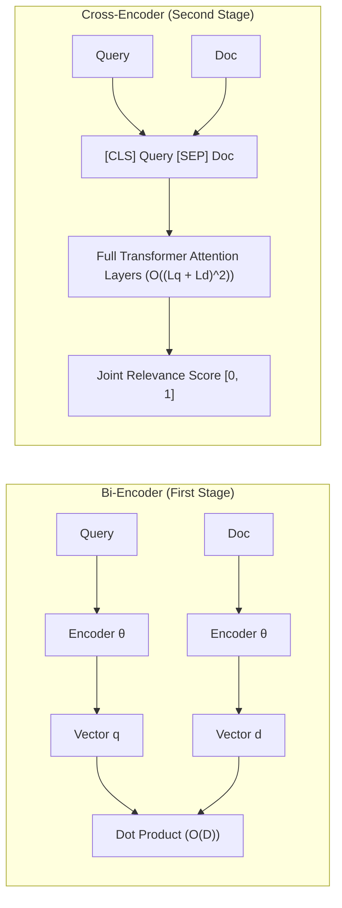

# Retrieval, Reranking & Hybrid Fusion: Mathematical & Algorithmic Deep Dive

Retrieval in modern RAG systems is fundamentally a multi-stage search optimization problem: balancing high recall over millions of items with high precision across the top-K context items.

---

## 1. Dense Semantic Vector Retrieval

### Mathematical Representation
A Dense Bi-Encoder $f_\theta: \mathcal{T} \to \mathbb{R}^D$ projects arbitrary text strings into a continuous $D$-dimensional metric space:
$$\mathbf{q} = f_\theta(Q), \quad \mathbf{d}_i = f_\theta(D_i)$$
Vectors are $L_2$-normalized:
$$\hat{\mathbf{v}} = \frac{\mathbf{v}}{\|\mathbf{v}\|_2} = \frac{\mathbf{v}}{\sqrt{\sum_{j=1}^D v_j^2}}$$
Consequently, Cosine Similarity simplifies to the Euclidean inner dot product:
$$\text{Sim}_{\text{cosine}}(\mathbf{q}, \mathbf{d}_i) = \frac{\mathbf{q} \cdot \mathbf{d}_i}{\|\mathbf{q}\| \|\mathbf{d}_i\|} = \hat{\mathbf{q}} \cdot \hat{\mathbf{d}}_i = \sum_{j=1}^D \hat{q}_j \hat{d}_{i,j}$$

### Computational Complexity
- **Exhaustive Matrix Multiplication**: $O(N \cdot D)$ FLOPs per query.
- **Approximate Nearest Neighbor (ANN)**: Hierarchical Navigable Small World (HNSW) graphs reduce retrieval complexity to $O(\log N)$ with sub-millisecond query latencies.

---

## 2. Sparse Lexical Retrieval: Okapi BM25

### Theoretical Formulation
Okapi BM25 (Robertson & Spärck Jones) evaluates exact lexical term occurrences weighted by Inverse Document Frequency (IDF) and penalized by document length:

$$BM25(D, Q) = \sum_{t \in Q} IDF(t) \cdot \frac{f(t, D) \cdot (k_1 + 1)}{f(t, D) + k_1 \cdot \left(1 - b + b \cdot \frac{|D|}{\text{avgdl}}\right)}$$

Where:
- $f(t, D)$: Term frequency of token $t$ in document $D$.
- $|D|$: Length of document $D$ in tokens.
- $\text{avgdl}$: Mean document length across the entire corpus: $\frac{1}{N} \sum_{i=1}^N |D_i|$.
- $k_1 \in [1.2, 2.0]$: Term frequency saturation parameter (default: $1.5$). Higher $k_1$ increases the importance of repeated terms.
- $b \in [0, 1]$: Document length penalty parameter (default: $0.75$). At $b=1$, full document length normalization is applied; at $b=0$, length normalization is disabled.
- $IDF(t)$: Robertson-Spärck Jones Inverse Document Frequency:
  $$IDF(t) = \ln\left(\frac{N - n(t) + 0.5}{n(t) + 0.5} + 1\right)$$
  where $N$ is total corpus size and $n(t)$ is count of documents containing term $t$.

---

## 3. Hybrid Fusion: Reciprocal Rank Fusion (RRF)

### The Scale Invariance Problem
Dense vector search yields cosine similarities bounded in $[-1, 1]$ (or $[0, 1]$ for normalized text). BM25 yields unbounded non-negative scores $[0, \infty)$ that scale with corpus size and vocabulary distribution. Directly adding or averaging these raw scores introduces extreme bias toward whichever system has larger variance.

### Reciprocal Rank Fusion (Cormack et al., 2009)
RRF discards raw score magnitudes entirely, operating solely on the ordinal ranks of candidate documents:

$$RRF(d) = \sum_{m \in M} \frac{1}{k + r_m(d)}$$

Where:
- $M = \{\text{dense}, \text{sparse}\}$: The set of independent retrieval systems.
- $r_m(d) \in \{1, 2, \dots\}$: The 1-based rank of document $d$ in retrieval system $m$.
- $k = 60$: The empirical smoothing constant. It prevents top-ranked outliers from dominating the sum.

### Properties of RRF
1. **Monotonicity**: Any document ranked highly in either system receives a large score boost.
2. **Consensus Bonus**: A document ranked #5 in Dense and #5 in BM25 will consistently beat a document ranked #1 in Dense but missing completely from BM25.
3. **Hyperparameter Invariance**: Requires zero calibration when changing embedding models or index configurations.

---

## 4. Second-Stage Neural Reranking: Bi-Encoder vs Cross-Encoder

### Computational Complexity & FLOPs
- **Bi-Encoder**: Queries and passages are encoded independently. No token-to-token attention exists between the query and passage. Complexity is $O(L_Q^2 + L_D^2)$. Enables indexing offline vectors.
- **Cross-Encoder**: Query and passage tokens are concatenated into a single sequence. Every token in the query attends to every token in the passage across all self-attention matrices:
  $$\text{Attention}(Q, K, V) = \text{softmax}\left(\frac{QK^T}{\sqrt{d_k}}\right)V$$
  Complexity is $O((L_Q + L_D)^2)$. Because query and passage must be processed together at runtime, offline vector indexing is impossible.
- **The Two-Stage Solution**:
  1. Retrieve top 50 candidates using Hybrid RRF in **< 20 ms**.
  2. Rerank the top 50 candidates using a lightweight Cross-Encoder (`ms-marco-MiniLM-L-6-v2`) in **< 45 ms**.
  3. Yields cross-encoder accuracy with sub-100ms end-to-end latency!

---

## 5. Hypothetical Document Embeddings (HyDE)
Gao et al. (2022) observed that questions and answer passages occupy different statistical manifolds in embedding space. A query like *"How to configure Redis quorum?"* has high lexical divergence from the technical answer *"A Redis cluster requires at least 3 master nodes..."*.

**HyDE Pipeline**:
1. Take user query $Q$.
2. Synthesize hypothetical passage $H = \text{LLM}(Q)$.
3. Embed $H$ into vector $\mathbf{v}_H = \text{Embed}(H)$.
4. Search corpus using $\mathbf{v}_H$. Since $\mathbf{v}_H$ is written in explanatory document prose, its embedding is geometrically closer to the target corpus passages than $Q$!
