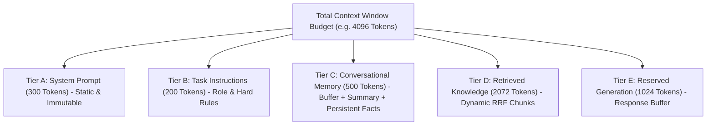

# Context Engineering & Memory Architecture

Context Engineering is the discipline of maximizing signal density within an LLM's finite attention window while strictly preventing context overflow, attention degradation, and prompt pollution.

---

## 1. The Token Budgeting Stack

In production agentic systems, context space must be deterministically partitioned into strict token tiers:

$$B_{\text{total}} = B_{\text{sys}} + B_{\text{inst}} + B_{\text{mem}} + B_{\text{ret}} + B_{\text{gen}}$$



### Context Overflow Prevention
If the retrieved chunks exceed the allotted retrieval budget $B_{\text{ret}}$:
1. ContextForge applies **Contextual Sentence Compression** to prune non-relevant sentences.
2. Low-ranked chunks are systematically dropped from the bottom of the rank list.
3. If memory grows large, the **SummaryMemory** compressor condenses past turns, keeping memory consumption $O(1)$.

---

## 2. Memory Tier Hierarchy

ContextForge organizes memory into three distinct operational tiers:

| Tier | Component | Storage Engine | Scope & Lifecycle | Eviction Policy |
| :--- | :--- | :--- | :--- | :--- |
| **Short-Term Buffer** | `BufferMemory` | In-Memory Deque | Current session (last $N=6$ turns) | FIFO Sliding Window |
| **Hierarchical Summary** | `SummaryMemory` | In-Memory String | Active session | LLM / Rule Summarization |
| **Persistent Episodic** | `PersistentMemoryStore` | SQLite Database | Cross-session persistent | Explicit update / Upsert |

### Persistent Memory Schema
```sql
CREATE TABLE IF NOT EXISTS memory_items (
    id INTEGER PRIMARY KEY AUTOINCREMENT,
    user_id TEXT NOT NULL,
    category TEXT NOT NULL, -- 'profile', 'preference', 'entity', 'constraint'
    key TEXT NOT NULL,
    value TEXT NOT NULL,
    confidence REAL DEFAULT 1.0,
    updated_at REAL NOT NULL,
    UNIQUE(user_id, category, key)
);
```

---

## 3. Mitigating the "Lost-in-the-Middle" Phenomenon

### Theoretical Foundation (Liu et al., Stanford/Berkeley 2023)
Language models do not attend to context uniformly across token positions. Empirical analysis reveals a pronounced **U-shaped attention curve**:

```
Attention Weight
  ▲
1.0│  ████                                                ████
   │  ████                                                ████
0.5│  ████                                                ████
   │  ████      ░░░░░░░░░░░░░░░░░░░░░░░░░░░░░░░░░         ████
0.0└──┴─────────┴─────────────────────────────────────────┴────►
     Start of Context (Primacy)   Middle (Lost Zone)   End (Recency)
```

- **Primacy Effect**: Information near the beginning of the prompt receives high attention due to initial key-value state conditioning.
- **Recency Effect**: Information immediately preceding the generation prompt receives high attention due to causal masking proximity.
- **Lost Zone**: When relevant documents are positioned in the center (40-60% of the context length), retrieval performance drops by up to **30-40%**!

### ContextForge Alternating Sorter Solution
Rather than placing chunks in strictly descending order $[1, 2, 3, 4, 5]$ (which pushes Rank 2 and Rank 3 into the middle!), ContextForge applies an alternating U-curve permutation:

$$\text{Input Ranks}: [1, 2, 3, 4, 5, 6]$$
$$\text{Reordered Sequence}: [1, 3, 5, 6, 4, 2]$$

- **Position 0 (Top)**: Rank #1 chunk (highest confidence).
- **Position -1 (Bottom)**: Rank #2 chunk (second highest confidence).
- **Position 1 (Inner Top)**: Rank #3 chunk.
- **Position -2 (Inner Bottom)**: Rank #4 chunk.
- **Center**: Lower-ranked supporting chunks.

This mathematical layout guarantees that the most critical evidence resides strictly within the high-attention regions of the Transformer context window.
