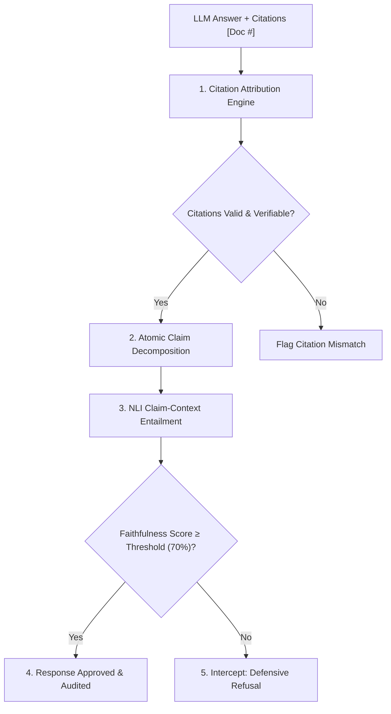

# Grounding Strategies, Citations & Hallucination Mitigation

The primary failure mode preventing enterprise adoption of generative AI is **hallucination**: when a model synthesizes claims that sound plausible and authoritative but are factually unsupported or directly contradicted by enterprise sources.

---

## 1. The Grounding Verification Pipeline

ContextForge enforces a multi-tiered verification pipeline that validates every answer before it reaches the user:



---

## 2. Inline Citation Attribution Engine (`CitationEngine`)

### Mechanics
1. **Regex Extraction**: Identifies inline reference tags matching standard syntax:
   $$\text{Pattern}: \verb|\[(?:Doc\s*#?|Source\s*#?)?(\d+)\]|$$
2. **Context Mapping**: Resolves reference indices against the 1-based retrieved chunk pool $[1 \dots K]$.
3. **Span Matching**: Extracts the assertion text preceding the citation and evaluates verbatim and fuzzy sequence similarity against the target chunk:
   $$\text{Overlap Ratio} = \frac{|\text{Tokens}(\text{Assertion}) \cap \text{Tokens}(\text{Chunk})|}{|\text{Tokens}(\text{Assertion})|}$$
4. **Validation Threshold**: Marks a citation as valid only if the overlap ratio exceeds $\tau_{\text{cit}} \ge 0.50$.
5. **Citation Coverage**: Computes the percentage of sentences backed by valid citations:
   $$\text{Coverage} = \frac{\sum_{i=1}^S \mathbb{I}(\text{Sentence}_i \text{ contains valid citation})}{S}$$

---

## 3. Claim-Level Entailment & Faithfulness Scoring (`GroundingVerifier`)

Rather than grading an entire answer with a single subjective score, ContextForge breaks the answer down into atomic factual statements:

1. **Claim Decomposition**: Normalizes sentence boundaries and isolates individual assertions.
2. **Dual-Signal Entailment**: For each claim $C_i$, computes:
   - **Dense Semantic Similarity**: $S_{\text{dense}}(C_i, \text{Chunk}_j) = \hat{\mathbf{c}}_i \cdot \hat{\mathbf{d}}_j$
   - **Lexical Entity Grounding**: $S_{\text{lex}}(C_i, \text{Chunk}_j) = \frac{|\text{Entities}(C_i) \cap \text{Entities}(\text{Chunk}_j)|}{|\text{Entities}(C_i)|}$
   - **Composite Entailment**:
     $$E(C_i) = 0.65 \cdot S_{\text{dense}} + 0.35 \cdot S_{\text{lex}}$$
3. **Support Criterion**: A claim is verified as supported if and only if:
   $$E(C_i) \ge \tau_{\text{entail}} \quad \text{AND} \quad S_{\text{lex}} \ge 0.15$$
   *(Requiring minimum lexical overlap prevents spurious cosine matches on out-of-domain topics!)*
4. **Faithfulness Metric**:
   $$\text{Faithfulness} = \frac{\sum_{i=1}^M \mathbb{I}(C_i \text{ is supported})}{M}$$

---

## 4. The RAG Triad Evaluation Metrics

ContextForge integrates the industry-standard RAG Triad framework:

```
                  ┌──────────────────────┐
                  │      User Query      │
                  └──────────┬───────────┘
                             │
            Context          │         Answer
            Relevance        │        Relevance
                             ▼
┌────────────────────┐   Synthesizes   ┌────────────────────┐
│  Retrieved Context ├────────────────►│  Generated Answer  │
└────────────────────┘                 └────────────────────┘
          ▲                                      │
          └──────────────────────────────────────┘
                        Faithfulness
                      (Groundedness)
```

1. **Context Relevance**: Measures whether retrieved chunks are relevant to the user query (retrieval precision).
2. **Faithfulness (Groundedness)**: Measures whether the generated answer is strictly entailed by the context (zero hallucination).
3. **Answer Relevance**: Measures whether the generated answer directly answers the query intent.
4. **Composite Harmonic Score**:
   $$\text{RAG Triad Score} = \frac{3}{\frac{1}{\text{Context Rel}} + \frac{1}{\text{Faithfulness}} + \frac{1}{\text{Answer Rel}}}$$

---

## 5. Defensive Refusal Guardrails

When a user query falls outside the knowledge base or retrieval returns low confidence:
- **Condition**: $\max_{i} \text{Score}(\text{Chunk}_i) < \tau_{\text{conf}}$ (e.g., $0.35$).
- **Action**: Intercept the pipeline before prompt assembly.
- **Output**: Deterministic defensive refusal:
  > *"I cannot answer this question with high confidence based strictly on the provided documents. The retrieved evidence does not sufficiently ground the answer."*
- **Outcome**: Completely avoids hallucinating fictitious facts!
