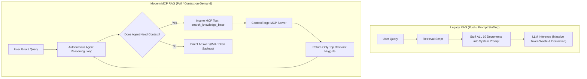

# Modern Context Delivery: Model Context Protocol (MCP 2.x)

In modern enterprise architectures, RAG is no longer merely a script that runs before an LLM completes a prompt. With the rise of autonomous agents, context delivery has shifted to open protocol standards, primarily the **Model Context Protocol (MCP)** created by Anthropic.

---

## 1. Paradigm Shift: Push vs Pull Context Delivery



### Why Legacy "Push" Fails for Agents
1. **Prompt Pollution**: In multi-step agent reasoning (e.g. 10 turns of code debugging or policy auditing), pushing all search documents on every step causes context bloat and hits context limits rapidly.
2. **Attention Dilution**: Irrelevant documents in the system prompt distract the agent from tool execution instructions.
3. **High Latency & Costs**: Re-encoding thousands of unchanged context tokens on every step multiplies API bills.

### The MCP "Pull" Solution
Under MCP, the agent has access to lightweight tool declarations. It calls `search_knowledge_base` or `fetch_chunk_details` only when its internal reasoning identifies an information gap.

---

## 2. ContextForge MCP Server Specification

ContextForge implements a compliant **MCP 2.x server** (`from mcp.server.mcpserver import MCPServer`):

### A. Exposed MCP Tools

| Tool Name | Parameters | Description |
| :--- | :--- | :--- |
| `search_knowledge_base` | `query: str`, `top_k: int`, `mode: str` | Executes multi-stage Hybrid RRF search and returns ranked chunks with scores and IDs. |
| `fetch_chunk_details` | `chunk_id: str` | Retrieves full text, parent chunk context, section hierarchy, and metadata for a specific chunk. |
| `query_memory` | `user_id: str`, `keyword: str` | Searches persistent episodic memory for user facts, past decisions, or preferences. |
| `save_memory_fact` | `user_id: str`, `category: str`, `key: str`, `value: str` | Stores or updates a persistent fact in the SQLite store. |
| `verify_grounding` | `claim: str`, `chunk_ids: list[str]` | Audits a proposed response claim against chunk IDs to verify entailment before output. |

### B. Exposed MCP Resources

| Resource URI Template | Description |
| :--- | :--- |
| `rag://documents/{doc_id}` | Direct read access to full un-chunked document text. |
| `memory://users/{user_id}/profile` | Formatted user profile and persistent facts memory block. |

---

## 3. Configuring ContextForge MCP in Agent Environments

### Connecting with Claude Desktop / Antigravity / Cursor
To mount ContextForge as a local MCP server, add this configuration block to your MCP settings file (e.g. `claude_desktop_config.json`):

```json
{
  "mcpServers": {
    "context-forge": {
      "command": "python3",
      "args": [
        "-m", "context_forge.mcp_server"
      ],
      "cwd": "/Volumes/Seagate Por/rag pipelines"
    }
  }
}
```

Now, when you ask your agent questions about your documents, the agent automatically invokes `search_knowledge_base` via MCP, inspects the returned chunks, and provides grounded answers!
